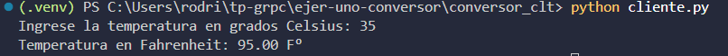

# Conversor de Celsius a Fahrenheit con gRPC

Este proyecto implementa una aplicación cliente-servidor en Python para convertir una temperatura de grados Celsius a grados Fahrenheit. El cliente solicita el valor al usuario y envía la operación al servidor mediante una llamada RPC de gRPC. El servidor calcula el resultado con la fórmula `F = C × 1.8 + 32` y devuelve la respuesta.

La comunicación se realiza por una conexión local sin cifrado (`127.0.0.1:50051`), apropiada para esta demostración.

## Estructura del proyecto

```text
.
├── conversor_clt/
│   ├── cliente.py
│   ├── conversor.proto
│   ├── conversor_pb2.py
│   └── conversor_pb2_grpc.py
└── conversor_srv/
    ├── servidor.py
    ├── conversor.proto
    ├── conversor_pb2.py
    └── conversor_pb2_grpc.py
```

- `conversor_clt/cliente.py`: pide la temperatura, invoca el método remoto e imprime el valor convertido con dos decimales.
- `conversor_srv/servidor.py`: inicia el servidor gRPC y realiza el cálculo.
- `conversor.proto`: contrato Protocol Buffers compartido por el cliente y el servidor. Hay una copia en cada carpeta para que cada componente pueda generar y usar sus módulos localmente.
- `conversor_pb2.py` y `conversor_pb2_grpc.py`: módulos generados a partir del `.proto`; contienen los mensajes, el stub del cliente y las interfaces del servicio. No se editan manualmente.

## Requisitos

- Python 3.
- `grpcio` y `protobuf`.

Desde la raíz del proyecto, instala las dependencias en el entorno virtual:

```powershell
.\.venv\Scripts\Activate.ps1
python -m pip install "grpcio>=1.85.0" "protobuf>=7.35.1"
```

Los archivos gRPC generados incluidos en el proyecto requieren `grpcio` 1.85.0
o posterior y el código Protobuf requiere `protobuf` 7.35.1 o posterior.

Si todavía no existe el entorno virtual, créalo primero con `python -m venv .venv`.

## Ejecución

Se necesitan dos terminales de PowerShell, ambas abiertas en la carpeta raíz
del proyecto y con el entorno virtual activado.

```powershell
.\.venv\Scripts\Activate.ps1
```

**Terminal 1 - inicia el servidor:**

   ```powershell
   cd conversor_srv
   python servidor.py
   ```

   El servidor queda esperando solicitudes en `127.0.0.1:50051`.

**Terminal 2 - ejecuta el cliente:**

   ```powershell
   cd conversor_clt
   python cliente.py
   ```

3. Ingresa una temperatura en Celsius cuando el cliente la solicite. Por ejemplo, al ingresar `35`, la salida es:

   ```text
   Ingrese la temperatura en grados Celsius: 35
   Temperatura en Fahrenheit: 95.00 F°
   ```

Para detener el servidor, presiona `Ctrl+C` en la primera terminal. Si el cliente recibe un texto que no se puede interpretar como número, informa que se debe ingresar un valor válido.

## Contrato Protocol Buffers

El archivo `conversor.proto` usa la sintaxis `proto3` y declara:

- El servicio `Conversor`.
- El método RPC unario `CelsiusAFahrenheit`, que recibe una `SolicitudTemperatura` y devuelve una `RespuestaTemperatura`.
- `SolicitudTemperatura`, con el campo `celsius` de tipo `float`.
- `RespuestaTemperatura`, con el campo `fahrenheit` de tipo `float`.

Las copias de `conversor.proto` en `conversor_clt/` y `conversor_srv/` contienen el mismo contrato. Si se modifica el contrato, se deben regenerar los módulos Python en ambas carpetas. Por ejemplo, con `grpcio-tools` instalado:

```powershell
python -m pip install grpcio-tools
cd conversor_clt
python -m grpc_tools.protoc -I. --python_out=. --grpc_python_out=. conversor.proto
cd ..\conversor_srv
python -m grpc_tools.protoc -I. --python_out=. --grpc_python_out=. conversor.proto
```

## Captura de la ejecución

La siguiente captura muestra una conversión de `35 °C` a `95.00 °F`:

