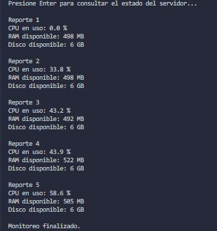

# Monitoreo de recursos con gRPC y Python

Aplicación cliente-servidor que consulta métricas de la máquina donde se ejecuta
el servidor. El servidor transmite cinco reportes de CPU, memoria RAM disponible
y espacio de disco disponible, con una pausa de dos segundos entre reportes.

## Estructura del proyecto

```text
.
├── monitoreo_clt/
│   ├── cliente.py
│   ├── monitoreo.proto
│   ├── monitoreo_pb2.py
│   └── monitoreo_pb2_grpc.py
└── monitoreo_srv/
    ├── servidor.py
    ├── monitoreo.proto
    ├── monitoreo_pb2.py
    └── monitoreo_pb2_grpc.py
```

## Requisitos

- Python 3.10 o posterior.
- Acceso a `127.0.0.1:50052` para la comunicación local.

## Instalación

Desde la carpeta raíz del proyecto, abre PowerShell y crea un entorno virtual:

```powershell
python -m venv .venv
.\.venv\Scripts\Activate.ps1
python -m pip install "grpcio>=1.85.0" "protobuf>=7.35.1" psutil
```

Los archivos gRPC generados incluidos en el proyecto requieren `grpcio` 1.85.0
o posterior y el código Protobuf requiere `protobuf` 7.35.1 o posterior.

## Ejecución

Se necesitan dos terminales de PowerShell, ambas abiertas en la carpeta raíz
del proyecto y con el entorno virtual activado.

**Terminal 1 — servidor:**

```powershell
.\.venv\Scripts\Activate.ps1
cd monitoreo_srv
python servidor.py
```

El servidor queda esperando solicitudes en `127.0.0.1:50052`.

**Terminal 2 — cliente:**

```powershell
.\.venv\Scripts\Activate.ps1
cd monitoreo_clt
python cliente.py
```

Presiona Enter cuando el cliente lo solicite. Se imprimirán los cinco reportes
y, al terminar el flujo, el mensaje `Monitoreo finalizado.`. Para detener el
servidor, presiona `Ctrl+C` en la primera terminal.

## Contrato Protobuf

El contrato está en [`monitoreo_clt/monitoreo.proto`](monitoreo_clt/monitoreo.proto)
y también en [`monitoreo_srv/monitoreo.proto`](monitoreo_srv/monitoreo.proto).
Ambos archivos describen el mismo servicio y deben mantenerse sincronizados.

```proto
syntax = "proto3";

service MonitorServidor {
    rpc ConsultarEstado (SolicitudVacia) returns (stream ReporteEstado);
}

message SolicitudVacia {}

message ReporteEstado {
    float cpu_uso_porcentaje = 1;
    float ram_disponible_mb = 2;
    float disco_disponible_gb = 3;
}
```

`ConsultarEstado` recibe una solicitud vacía y responde con un flujo de mensajes
`ReporteEstado`. Cada mensaje contiene el porcentaje de CPU en uso, la RAM
disponible en MB y el espacio disponible en disco en GB.

## Implementaciones

- [Servidor (`servidor.py`)](monitoreo_srv/servidor.py): obtiene las métricas
  con `psutil`, genera cinco respuestas y publica el servicio gRPC.
- [Cliente (`cliente.py`)](monitoreo_clt/cliente.py): se conecta al servidor,
  consume el flujo e imprime cada reporte.
- [Código Protobuf generado](monitoreo_srv/monitoreo_pb2.py) y
  [clases gRPC generadas](monitoreo_srv/monitoreo_pb2_grpc.py): código de soporte
  generado a partir del `.proto`; no se edita manualmente. El directorio del
  cliente contiene sus copias para que ambas implementaciones puedan ejecutarse
  desde sus respectivas carpetas.

## Captura de ejecución

La siguiente captura muestra una ejecución del cliente con los cinco reportes:

